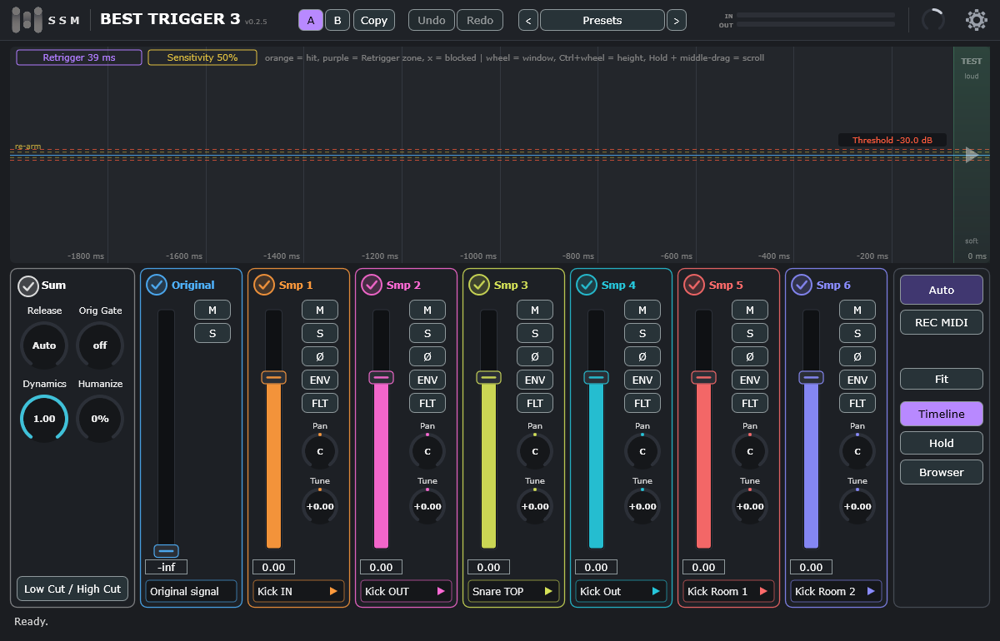

# Best Trigger 3

**Drum trigger plugin (VST3) with an oscilloscope.** · **Плагин-триггер для барабанов (VST3) с осциллографом.**

**Manual · Руководство:** [English](https://bardinguitars.github.io/Best-Trigger-3/manual-en.html) · [Русский](https://bardinguitars.github.io/Best-Trigger-3/manual-ru.html)

**Changelog · История изменений:** [CHANGELOG.md](CHANGELOG.md)

> Proprietary software. © 2026 SSM-Audio. All rights reserved. This page only carries the installers (see [Releases](../../releases)).

## English

| | **Best Trigger 3 Free** | **Best Trigger 3** |
|---|---|---|
| Samples | six built-in | your own |
| Browser, library, `.tci` migration | no | yes |
| Key | `thankyou` | your licence key |

1. Download the installer for your system from **[Releases](../../releases/latest)**.
2. Run it. If Windows shows a blue warning: **More info → Run anyway**. On macOS: right-click the `.pkg` → **Open** ([details](docs/INSTALL-macOS.md)).
3. Rescan plugins in your DAW, insert the plugin on a drum track, enter the key. Internet is needed once.

Windows 10/11 64-bit or macOS 10.15+; a DAW with VST3.

## Русский

| | **Best Trigger 3 Free** | **Best Trigger 3** |
|---|---|---|
| Сэмплы | шесть встроенных | ваши |
| Браузер, библиотека, миграция `.tci` | нет | да |
| Ключ | `thankyou` | ваш лицензионный ключ |

1. Скачайте установщик для вашей системы на странице **[Releases](../../releases/latest)**.
2. Запустите его. Если Windows показывает синее предупреждение: **Подробнее → Выполнить в любом случае**. На macOS: правый щелчок по `.pkg` → **Открыть** ([подробнее](docs/INSTALL-macOS.md)).
3. Пересканируйте плагины в DAW, вставьте плагин на дорожку барабана, введите ключ. Один раз нужен интернет.

Windows 10/11 (64 бита) или macOS 10.15+; DAW с поддержкой VST3.

---

© 2026 SSM-Audio. VST is a trademark of Steinberg Media Technologies GmbH. [THIRD_PARTY_NOTICES.md](THIRD_PARTY_NOTICES.md)
