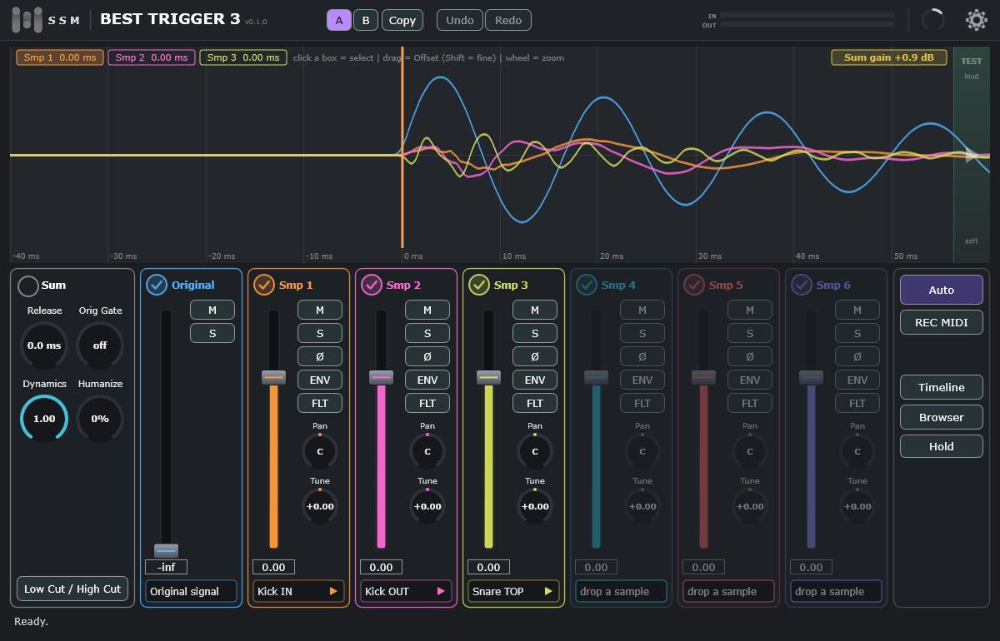

# Best Trigger 3

**Drum trigger plugin (VST3) with an oscilloscope.** Replace or add to the sound of a drum with samples: set the threshold and the
phase by eye on the scope, or let the Auto tools do it. · **Плагин-триггер для барабанов (VST3) с осциллографом.**

[English](#english) · [Русский](#русский) · **Manual / Руководство:** [English](https://bardinguitars.github.io/Best-Trigger-3/manual-en.html) · [Русский](https://bardinguitars.github.io/Best-Trigger-3/manual-ru.html)

> **Best Trigger 3 is proprietary software. © 2026 SSM. All rights reserved.** This repository only carries the installers
> (see [Releases](../../releases)) and the information about them. The program is not open source and may not be copied,
> changed or redistributed without permission.

---

## English

### Two versions

| | **Best Trigger 3 Free** | **Best Trigger 3** (full) |
|---|---|---|
| Samples | six built-in multisamples (Kick IN / OUT / SUB, Snare TOP / BOTTOM, Tom) | **your own** samples, folders, `.bt3` libraries |
| Sample browser, library folder, `.tci` migration | no | yes |
| Everything else (scope, Auto tools, mixer, filters, MIDI, A/B, undo) | yes | yes |
| Activation | free key: `thankyou` | licence key (one computer at a time) |

Both can be installed side by side: they have different names in your DAW.

### Install on Windows
1. Download the installer from **[Releases](../../releases/latest)**: `BestTrigger3-Free-…-Setup.exe` or `BestTrigger3-…-Setup.exe`.
2. Run it. Windows may show a blue *"Windows protected your PC"* window, because the installer is not signed with a paid
   certificate: click **More info → Run anyway**.
3. Rescan plugins in your DAW. The plugin is installed in `C:\Program Files\Common Files\VST3`.
4. On the first start enter the key (the free version: `thankyou`). An internet connection is needed once, for the activation.

### Install on macOS
1. Download `BestTrigger3-Free-…-macOS.pkg` or `BestTrigger3-…-macOS.pkg` from **[Releases](../../releases/latest)** (works on Apple chips and Intel).
2. The installer is **not notarised by Apple** (Apple's developer programme cannot be paid for from Russia), so macOS warns you the first time: right-click the `.pkg` → **Open** → **Open**. If your DAW does not show the plugin, see **[macOS: allowing the plugin](docs/INSTALL-macOS.md)**.

### Updates
The plugin checks this page once at every start. When a new release appears, a small red dot shows next to the gear icon.

### Requirements
Windows 10/11 64-bit, or macOS 10.15 or newer (Apple chips and Intel); a DAW that supports VST3. Stereo effect or insert on a drum track.

---

## Русский

### Две версии

| | **Best Trigger 3 Free** | **Best Trigger 3** (полная) |
|---|---|---|
| Сэмплы | шесть встроенных мультисэмплов (Kick IN / OUT / SUB, Snare TOP / BOTTOM, Tom) | **ваши** сэмплы, папки, библиотеки `.bt3` |
| Браузер сэмплов, папка библиотеки, миграция `.tci` | нет | да |
| Всё остальное (осциллограф, Auto, микшер, фильтры, MIDI, A/B, undo) | да | да |
| Активация | бесплатный ключ: `thankyou` | лицензионный ключ (один компьютер) |

Версии ставятся рядом: в DAW у них разные названия.

### Установка на Windows
1. Скачайте установщик на странице **[Releases](../../releases/latest)**: `BestTrigger3-Free-…-Setup.exe` или `BestTrigger3-…-Setup.exe`.
2. Запустите его. Windows может показать синее окно *«Windows защитил ваш компьютер»*: установщик не подписан платным
   сертификатом. Нажмите **«Подробнее» → «Выполнить в любом случае»**.
3. Пересканируйте плагины в DAW. Плагин устанавливается в `C:\Program Files\Common Files\VST3`.
4. При первом запуске введите ключ (бесплатная версия: `thankyou`). Для активации один раз нужен интернет.

### Установка на macOS
1. Скачайте `BestTrigger3-Free-…-macOS.pkg` или `BestTrigger3-…-macOS.pkg` на странице **[Releases](../../releases/latest)** (работает на чипах Apple и на Intel).
2. Установщик **не нотаризован Apple** (платную программу разработчика Apple из России оплатить нельзя), поэтому при первом запуске macOS предупредит вас: нажмите на `.pkg` правой кнопкой → **Открыть** → **Открыть**. Если DAW не видит плагин, смотрите **[macOS: как разрешить плагин](docs/INSTALL-macOS.md)**.

### Обновления
Плагин проверяет эту страницу при каждом запуске. Когда выходит новая версия, рядом с шестерёнкой загорается небольшая красная точка.

### Требования
Windows 10/11 (64 бита) или macOS 10.15 и новее (чипы Apple и Intel); DAW с поддержкой VST3. Ставится на дорожку барабана как эффект (вставка).

---

© 2026 SSM. All rights reserved. VST is a trademark of Steinberg Media Technologies GmbH. Third-party software: see
[THIRD_PARTY_NOTICES.md](THIRD_PARTY_NOTICES.md).
